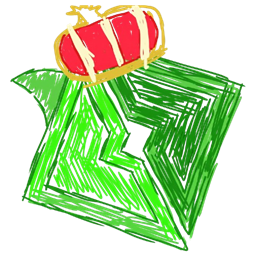
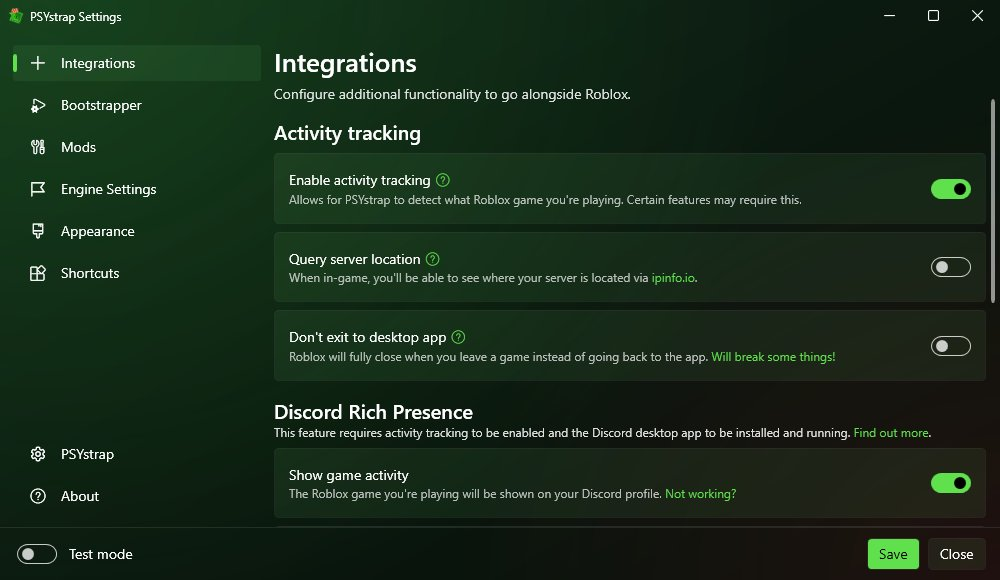
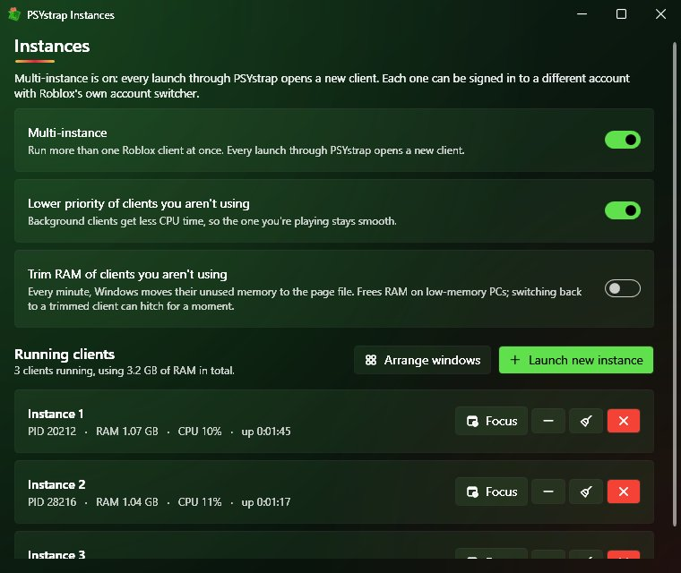
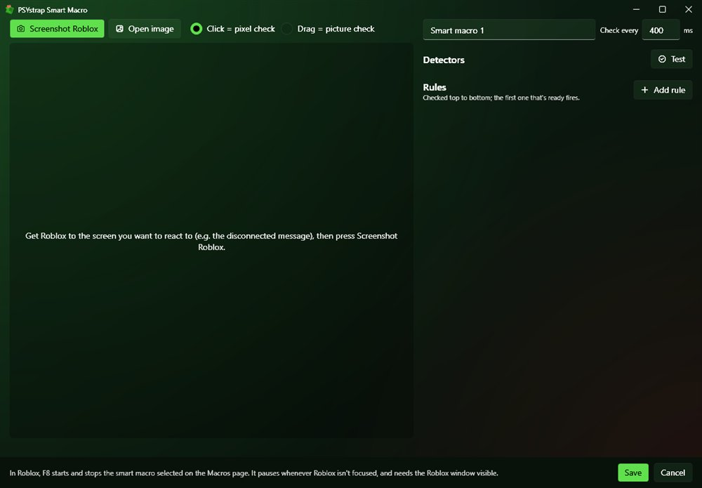
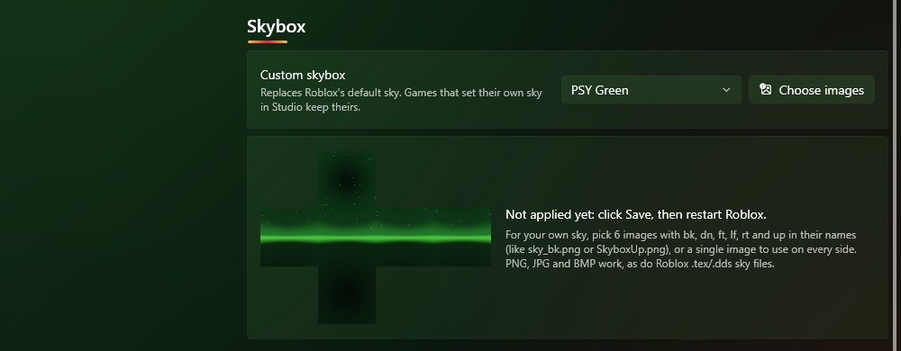

<div align="center">



# PSYstrap

A Roblox launcher based on Bloxstrap, with an overlay, multi instance, saved accounts and macros added on top.

[](https://github.com/PSYGATOR/PSYSTRAP/releases/latest)
[](LICENSE)

**[Download](https://github.com/PSYGATOR/PSYSTRAP/releases/latest)** | **[Website](https://psygator.github.io/PSYSTRAP/)** | **[Wiki](https://psygator.github.io/PSYSTRAP/wiki/)**

</div>

## What it does

Everything Bloxstrap does (mods, fast flags, Discord status, etc.), plus:

- **Overlay** - FPS, CPS, RAM, session time, a clock, server player count and today's playtime in the corner of Roblox. Press Insert in game for a menu with the FPS cap, potato mode and a "go to smallest server" button.
- **Multi instance** - run as many Roblox windows as you want. There's a window to manage them (lower their priority, trim RAM, tile them on screen).
- **Saved accounts** - log in once on the normal Roblox login page and you can open that account later in one click, even straight into the server your main is in.
- **Macros** - F6 to record, F7 to play.
- **Smart macros** - watch the screen for a colour, a picture or some text and do something when it shows up. For example: if the disconnected message shows up, rejoin. Press F8 to run one.
- **Turn taking** - run smart macros on all your Roblox windows by switching between them really fast.
- **Custom skybox** - a few presets, or use your own images.
- **Potato mode** - lowest graphics in one click.
- **Everyday stuff** - rejoin when you get disconnected, anti-AFK, remap keys and side mouse buttons, a different FPS cap or potato mode per game, playtime per game, a popup when a friend starts playing, background windows muted.
- **AFK tools** - favourites with desktop shortcuts, start with Windows, open and close games on a schedule, reopen Roblox if it crashes or freezes, minimize windows to the tray, and messages to your phone (Discord webhook) when something goes wrong.
- **Server browser** - every public server of a game with player counts, join any of them as any saved account.
- **Settings tools** - remove fast flags Roblox ignores, fast flag and mod profiles, import from Bloxstrap or Fishstrap, and backups.
- **Better Discord status** - player count and region of your server, hide games you don't want to show, use your own Discord app, and with several windows it shows the one you're using.
- A green theme to match the logo.

It doesn't inject anything into Roblox or touch its memory. It only changes Roblox's own settings files and sends normal keyboard and mouse input.

## Screenshots

<table>
  <tr>
    <td width="50%"></td>
    <td width="50%"></td>
  </tr>
  <tr>
    <td></td>
    <td></td>
  </tr>
</table>

## Install

1. Get `PSYstrap.exe` from [releases](https://github.com/PSYGATOR/PSYSTRAP/releases/latest).
2. Run it and click Install.
3. Play Roblox like normal. It opens through PSYstrap now.

You need Windows 10 or 11 and the [.NET 6 Desktop Runtime](https://dotnet.microsoft.com/download/dotnet/6.0) (Windows will ask to install it if you don't have it). It updates itself when there's a new release.

Hotkeys in game: **Insert** menu, **F6** record macro, **F7** play macro, **F8** smart macro.

How everything works is in the [wiki](https://psygator.github.io/PSYSTRAP/wiki/).

## Building

```
git clone --recursive https://github.com/PSYGATOR/PSYSTRAP.git
cd PSYSTRAP
powershell -ExecutionPolicy Bypass -File fork\build.ps1
```

The exe ends up in `fork\dist`. More info on the [building page](https://psygator.github.io/PSYSTRAP/wiki/Building.html).

## Credits

Based on [Bloxstrap](https://github.com/bloxstraplabs/bloxstrap) by pizzaboxer and contributors (MIT license, see [LICENSE](LICENSE)). Not affiliated with Roblox or the Bloxstrap team.
