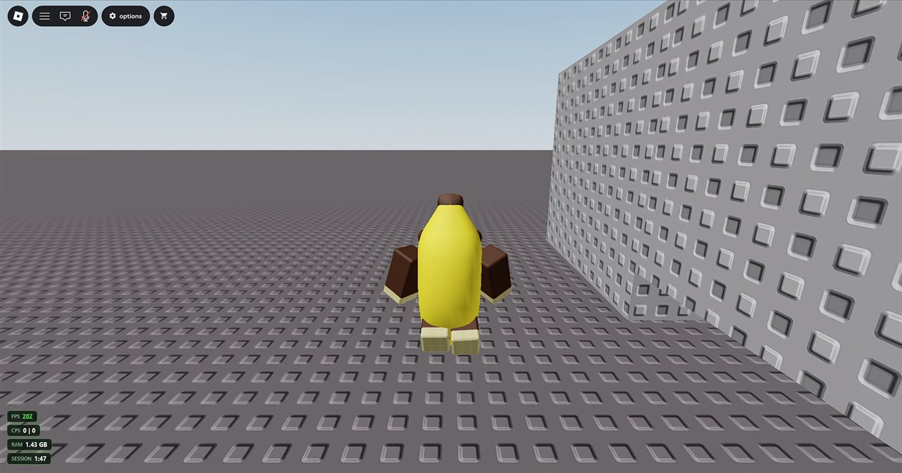
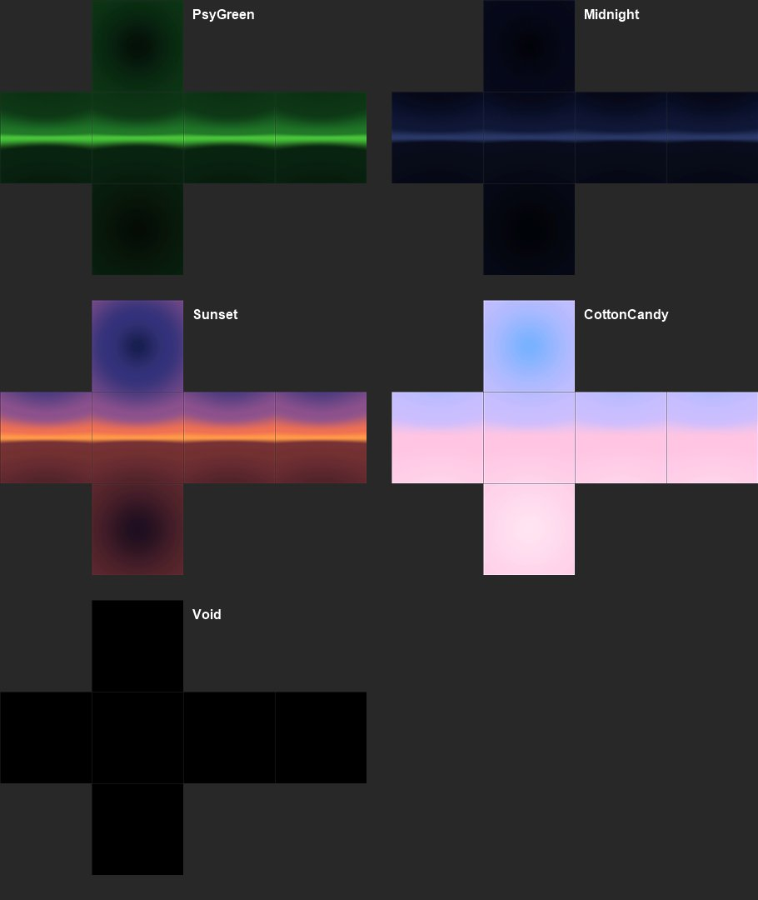

<div align="center">


# PSYstrap

**The Roblox launcher with a crown on.**
Overlay, multi-instance, saved accounts and smart macros, built on Bloxstrap and themed in green.

[](https://github.com/AGamingotter/PSYSTRAP/releases/latest)
[](https://github.com/AGamingotter/PSYSTRAP/releases)
[](https://github.com/AGamingotter/PSYSTRAP/actions)

[](LICENSE)

### [⬇ Download the latest PSYstrap.exe](https://github.com/AGamingotter/PSYSTRAP/releases/latest)



</div>

---

## ✨ Why PSYstrap?

|  |  |
|---|---|
| 🎮 **In-game overlay** | FPS, clicks per second, RAM, session time and a clock, drawn over Roblox. Press **Insert** for a quick menu. |
| 🪟 **Multi-instance** | Run several Roblox clients at once, with an instance manager to tile, prioritise and trim them. |
| 👥 **Saved accounts** | Sign in once and launch any account straight into a friend's server, the emptiest server, or any game. |
| ⌨️ **Macros** | **F6** records, **F7** plays. Playback pauses whenever Roblox isn't focused. |
| 🧠 **Smart macros** | Watch the screen for colours, pictures or **text** and react: *"Disconnected seen → rejoin"*. |
| 🔁 **Turn-taking** | One smart macro per client, cycled automatically. It hands control back the moment you touch the mouse. |
| 🌌 **Custom skyboxes** | Five built-in presets or your own six images. |
| 🥔 **Potato mode** | Lowest graphics in one switch, for weak PCs, weak Wi-Fi and background clients. |
| 💚 **PSY theme** | A dark-green UI built around the logo. |

> 🛡️ **No injection, ever.** PSYstrap only uses Roblox's own files and settings, normal Windows APIs and normal input. It never touches the game's memory.

---

## 📸 A look around

<table>
  <tr>
    <td width="50%"><br><sub><b>Settings</b>, in the PSY theme</sub></td>
    <td width="50%"><br><sub><b>Instances</b>: three clients at once, with RAM and CPU for each</sub></td>
  </tr>
  <tr>
    <td><br><sub><b>Smart macro editor</b>: screenshot, mark, add rules</sub></td>
    <td><br><sub><b>Skybox</b> picker with a live preview</sub></td>
  </tr>
</table>

<details>
<summary>🌌 Built-in skybox presets</summary>
<br>

</details>

---

## 🚀 Getting started

1. **[Download `PSYstrap.exe`](https://github.com/AGamingotter/PSYSTRAP/releases/latest)** from the latest release.
2. Run it and click **Install**. PSYstrap becomes your Roblox launcher, so the website's **Play** button opens Roblox through it.
3. Open **PSYstrap Settings** from the Start menu to set up the overlay, macros, skybox and instances.

You need Windows 10 or 11 and the [.NET 6 Desktop Runtime](https://dotnet.microsoft.com/download/dotnet/6.0); Windows offers to install it if it's missing. PSYstrap updates itself whenever a new release comes out.

### ⌨️ Hotkeys (in Roblox)

| Key | Does |
|---|---|
| `Insert` | Open or close the PSYstrap menu (changeable) |
| `F6` | Start or stop recording a macro |
| `F7` | Play or stop the selected macro |
| `F8` | Start or stop the selected smart macro |

---

## ❓ FAQ

<details>
<summary><b>Will this get me banned?</b></summary>

PSYstrap doesn't inject into Roblox, read or write its memory, or bypass anything. It works like Bloxstrap: launcher settings, Roblox's own settings file, file mods and normal Windows input. Macros are still automation, though, and some games' own rules don't allow AFK macros, so check the game you play.
</details>

<details>
<summary><b>My custom skybox shows for a second, then disappears.</b></summary>

That game sets its own sky, which replaces Roblox's default one (the one PSYstrap changes). The custom sky shows in games that don't set their own.
</details>

<details>
<summary><b>Why can't macros run on every client at the same time?</b></summary>

Roblox only reads input from the focused window. Turn-taking gets close by switching between clients quickly and pausing as soon as you use the PC.
</details>

<details>
<summary><b>Where are my saved accounts stored?</b></summary>

In `%LocalAppData%\PSYstrap\Accounts.json`, encrypted with Windows DPAPI for your Windows user only. You sign in on Roblox's own page, so PSYstrap never sees or stores your password.
</details>

<details>
<summary><b>The FPS counter says n/a.</b></summary>

It reads Windows performance events, which needs admin or the *Performance Log Users* group, and only sees Roblox's Direct3D renderer (not Vulkan or OpenGL).
</details>

---

## 🛠️ Building it yourself

```powershell
git clone --recursive https://github.com/AGamingotter/PSYSTRAP.git
cd PSYSTRAP
powershell -ExecutionPolicy Bypass -File fork\build.ps1
```

This produces a single `fork\dist\PSYstrap.exe`. Use that file, not the `bin` output: a plain `dotnet build` makes a launcher plus DLLs, and the installer only copies the exe.

**Releasing:** push a tag newer than the version in `Bloxstrap/Bloxstrap.csproj` (for example `git tag v2.12.1` then `git push origin v2.12.1`). The **Build** workflow publishes a release with the exe, and installed copies update themselves.

---

<div align="center">

**Credits**: PSYstrap is based on [Bloxstrap](https://github.com/bloxstraplabs/bloxstrap) by pizzaboxer and contributors, used under the [MIT License](LICENSE).
Not affiliated with Roblox Corporation or the Bloxstrap project.


</div>
