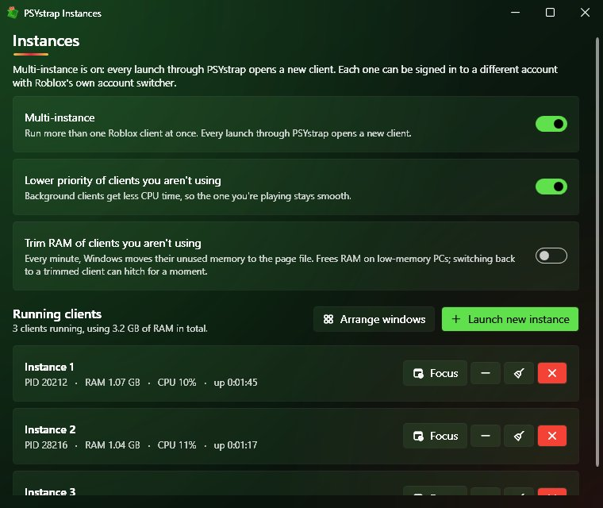

# 🪟 Multi-instance

Run more than one Roblox client at a time.

## Turning it on

Open the **Instances** window: **Settings → Instances**, or **Instances and macros** in the in-game menu. Switch on **Multi-instance**. From then on, every launch through PSYstrap opens a new client instead of switching to the one that's already open.

> ⚠️ If Roblox was already open when you turned it on, close every Roblox window once. Multi-instance starts working from the next launch.

## The Instances window

| Control | What it does |
|---|---|
| **Launch new instance** | Opens another client |
| **Arrange windows** | Tiles every client in a grid (handy for [turn-taking](Turn-taking.md)) |
| Per client: **Focus / Minimise / Trim RAM / Close** | Manage one client |
| **Lower priority of clients you aren't using** | Background clients get less CPU, so the one you play stays smooth (on by default) |
| **Trim RAM of clients you aren't using** | Every minute, Windows moves background clients' unused memory to the page file. It frees a lot of RAM, but switching back can hitch briefly (off by default) |

Each client shows its RAM, CPU and uptime. Combined with [potato mode](Overlay.md#potato-mode-disable-graphics), background clients can be very light.

## Different accounts

Every client can be signed in to a different account. Either use Roblox's own account switcher in each client, or let PSYstrap open saved accounts for you (see [Accounts](Accounts.md)).

## How it works (for the curious)

Roblox blocks a second client in two ways:

1. **Session-wide lock names.** A small background PSYstrap process claims these before the first client starts.
2. **A guard tied to the folder the client runs from.** Each extra client starts from its own folder link (`Instances\2`, `Instances\3`, …) that points at the same Roblox files.

Nothing is copied, nothing is injected, and no Roblox files are changed. Up to 16 clients are supported.
