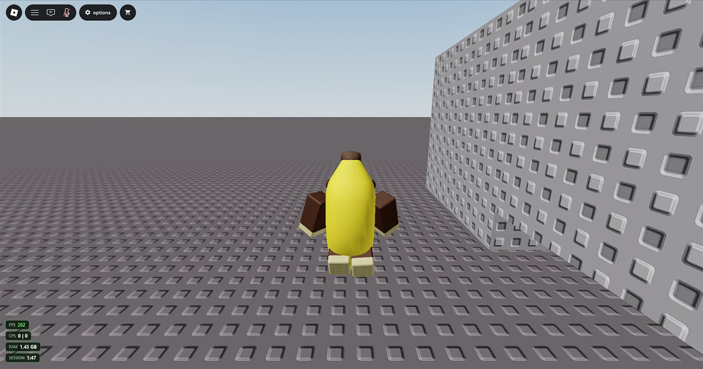

# 🎮 Overlay

The overlay is a set of small counters drawn on top of the Roblox window, plus a menu you open with a key. It's a separate window over Roblox; nothing goes inside the game.

## Counters

| Counter | Shows |
|---|---|
| **FPS** | Frames Roblox draws per second. Green at 55 and above, gold at 30 and above, red below 30 |
| **CPS** | Left \| right clicks in the last second, counted only while Roblox is focused |
| **RAM** | Memory the Roblox client is using |
| **Session** | How long Roblox has been open |
| **Clock** | Your PC's time |

Turn each one on or off, and pick the corner, under **Settings → Overlay** or in the in-game menu. The counters hide whenever Roblox isn't the focused window.

> ⚠️ The overlay shows in **windowed** and **borderless fullscreen** (F11) Roblox. **Exclusive fullscreen** (the Alt+Enter Fast Flag preset) draws over everything, so the overlay can't appear there.

### FPS says "n/a"?

The FPS counter reads Windows' own frame timing events. That needs either administrator rights or membership of the **Performance Log Users** Windows group, and it only sees Roblox's default **Direct3D** renderer, not Vulkan or OpenGL.

## The in-game menu

Press **Insert** while Roblox is focused (you can change the key to Right Shift, Home or F10). Press it again, or click back into Roblox, to close it. Changes save straight away.

### Frame-rate cap

PSYstrap writes your cap into Roblox's own settings file just before each launch. It's the same setting as Roblox's *Maximum frame rate*. The choices match Roblox's own (Default 60, 60, 120, 144, 240), because Roblox ignores anything else.

Roblox only reads the cap when it starts. To apply a change mid-game, press **Restart Roblox to apply**: Roblox closes and reopens straight into the same server.

### Potato mode (disable graphics)

One switch for the lightest Roblox can run: lowest textures, no grass, lowest level of detail, lighting updates paused, and graphics quality 1. It's good for weak PCs, weak Wi-Fi (far less to download when joining a game) and background clients. It only uses flags on Roblox's official allowlist, and it applies to every client from the next launch.

### Hop to the smallest server

Moves you to the emptiest public server of the game you're in. It reads the same server list as Roblox's **Servers** tab.

### Instances and macros

Opens the [Instances window](Multi-instance.md).
