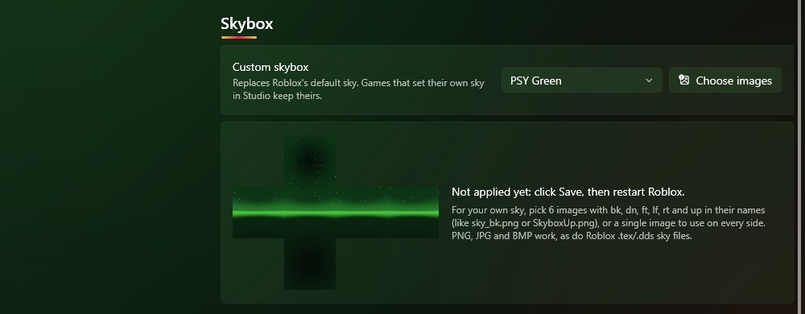
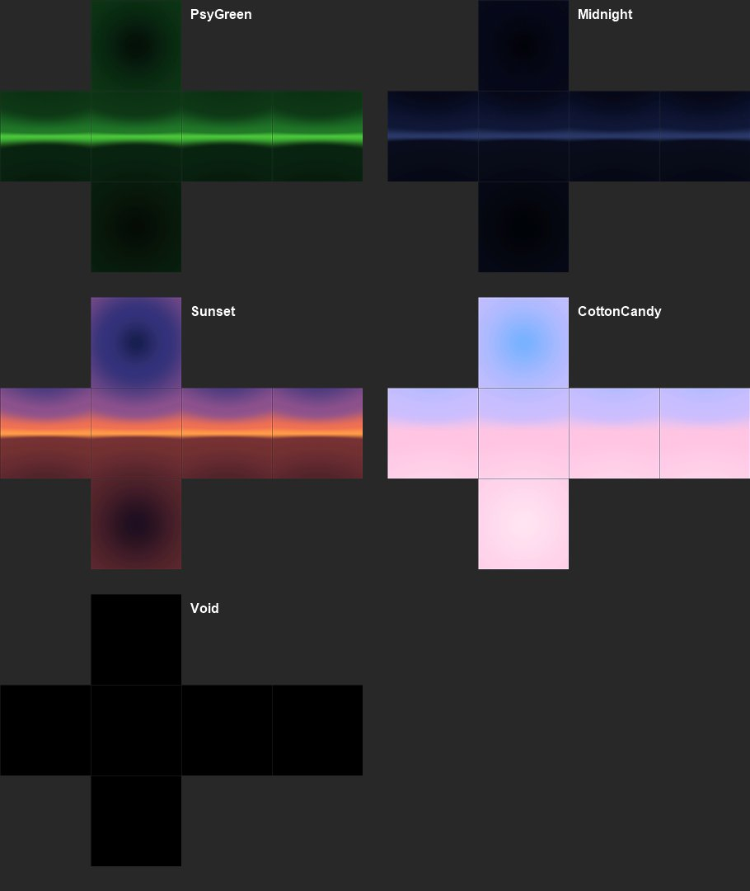

# Skybox

Settings > Mods > Skybox. Pick one, hit Save, restart Roblox.

## Presets

PSY Green, Midnight, Sunset, Cotton Candy and Void (all black).

## Using your own images

Click "Choose images" and select either:

- 6 images with the side in the name: `bk`, `dn`, `ft`, `lf`, `rt`, `up` (or `back`, `down`, `front`, `left`, `right`, `top`). So `sky_bk.png`, `SkyboxUp.png` and so on.
- or just 1 image and it gets used for every side.

PNG, JPG, BMP and Roblox `.tex`/`.dds` sky files all work. Size doesn't matter, they get resized. Skybox packs made for Roblox should line up fine.

Pick "Roblox default" to go back to normal.

## My sky shows up for a second then goes away

That game has its own sky. PSYstrap can only change Roblox's default sky, and lots of games (shooters, showcases, even new baseplates) put their own sky in, which loads right after you join. There's no setting that can force it, so the custom sky only shows in games that don't have one.
