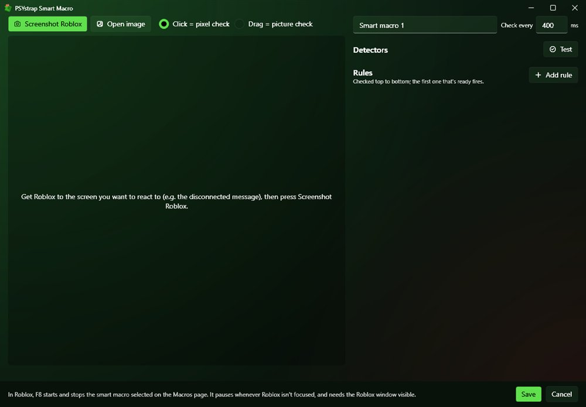

# 🧠 Smart macros

A smart macro watches the Roblox window and reacts to it:

> *When **Disconnected** is seen for 2 s → **Rejoin server***
> *When **Bag full** is seen → **Play macro** Sell*

Create one in **Settings → Macros → Smart macros → New**, select it there, and press **F8** in Roblox to start or stop it.

## 1. Take a screenshot

Get Roblox to the screen you want to react to (the error popup, the full-bag icon…), then press **Screenshot Roblox**. The editor gets out of the way while it captures. **Open image** loads a screenshot you saved earlier.

> 💡 **Make smart macros at the window size they'll run at.** Detector positions are stored relative to the window, but Roblox's top bar and some game UI stay the same pixel size at any window size. If you'll run several clients side by side, press **Arrange windows** first and screenshot a client at that size.

## 2. Add detectors

Choose a mode, then click or drag on the screenshot:

| Mode | You… | It checks for… | Tune it with |
|---|---|---|---|
| **Pixel check** | click a spot | that spot being (close to) that colour | **Colour tolerance** (0–255, default 30) |
| **Picture check** | drag a box | that picture appearing near where it was (it can shift about 8% of the window) | **Match %** (default 90) |
| **Text check** | drag a box | that area containing some text, read with Windows' built-in OCR | the **text to look for** (filled in for you) |

Text checks ignore capital letters, spaces and punctuation, so `Dis-connected!` still matches `disconnected`. Shorten the text to the important word if the area holds more than you need.

Rename detectors so your rules read nicely (*Reconnect button*, *Bag full*…). **Test** checks every detector against the current screenshot and shows ✔/✘, plus what the text check read. Take another screenshot in a different situation to check the opposite.

## 3. Add rules

Each rule reads: **When** *detector* **is seen / is gone** **for** *N* seconds **→** *action*.

| Action | Does |
|---|---|
| **Play macro** | Plays one of your [macros](Macros.md) once |
| **Press key** | Taps a key: `E`, `Space`, `F`, `1`, `LeftShift`, `Enter`… |
| **Click it** | Clicks where the detector found its target (the picture or text box, or the pixel) |
| **Wait (seconds)** | Waits |
| **Rejoin server** | Closes Roblox and opens it back in the same server |
| **Stop smart macro** | Stops |

- Rules are checked **top to bottom**, and the **first** one that's ready fires. Use ↑ to reorder.
- **Wait at least N s before firing again** is a cooldown, so a rule doesn't spam.
- **Check every … ms** (default 400) sets how often the screen is read.

## Running it

Press **F8** in Roblox. The overlay shows ◆ *name*: what fired last. Press **F8** again to stop.

- It **pauses whenever Roblox isn't focused**, and the Roblox window must be **visible** (not minimised or covered), because it reads the screen.
- While it runs, PSYstrap's own overlay is hidden from the screenshots so it can't confuse detectors (this also hides it from OBS and screenshots meanwhile).

To run smart macros on several clients, see [Turn-taking](Turn-taking.md).

## Example: auto-reconnect

1. Get the *Disconnected* popup on screen and take a screenshot.
2. Choose **Text check** and drag over the popup's title. It reads *Disconnected*.
3. Choose **Picture check** and drag over the **Reconnect** button. Name it *Reconnect*.
4. Add two rules:
   - When *Reconnect* is seen → **Click it** (cooldown 5 s)
   - When *Disconnected* is seen for 15 s → **Rejoin server**
5. **Save**, select it on the Macros page, and press **F8** in game.
